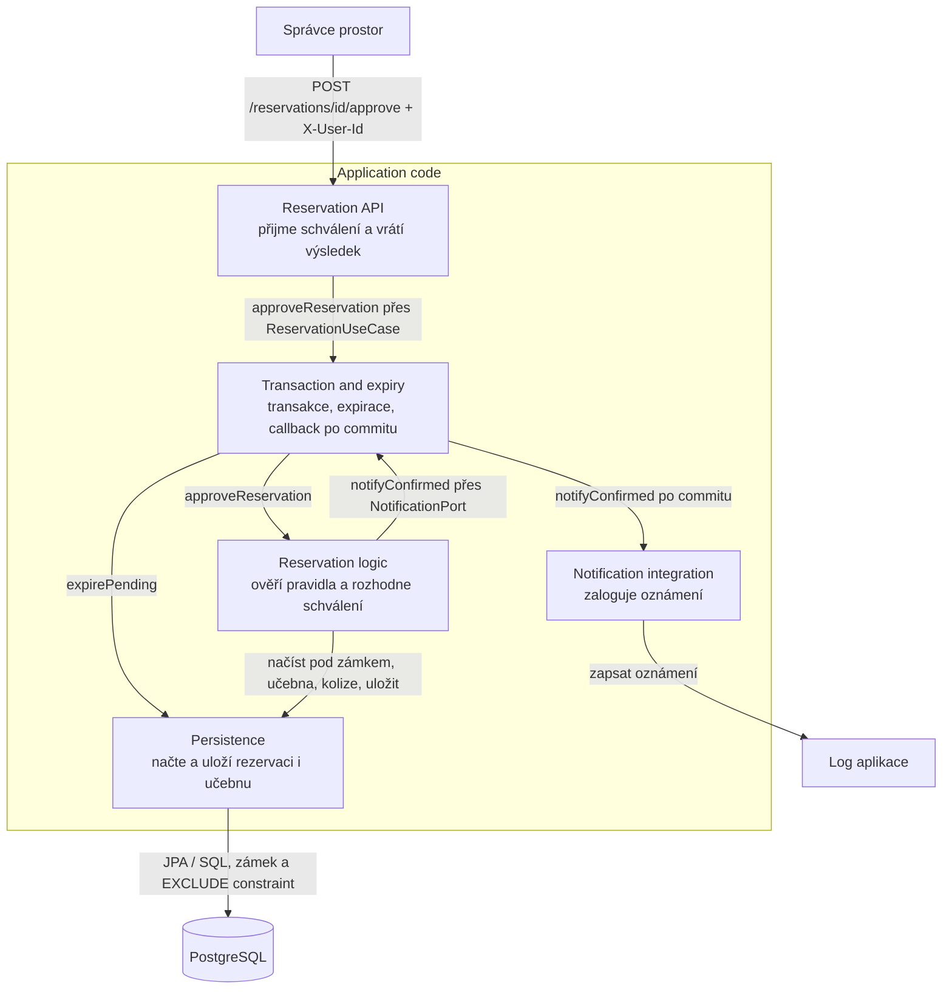
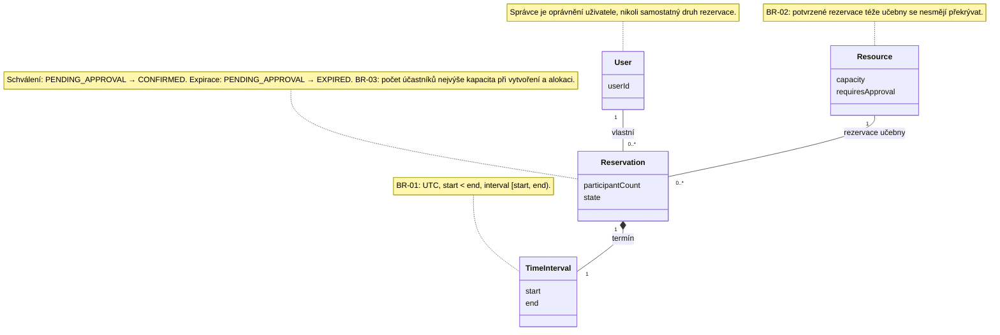
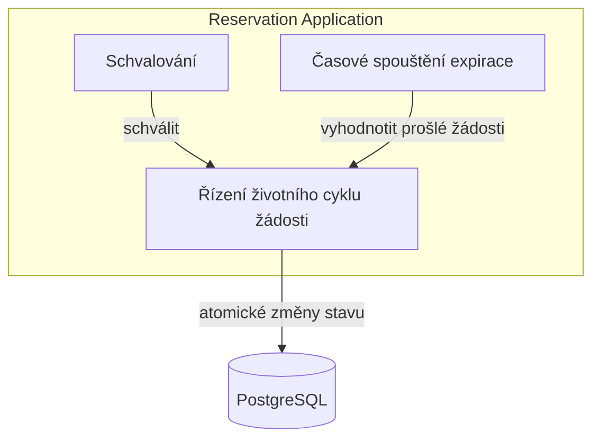
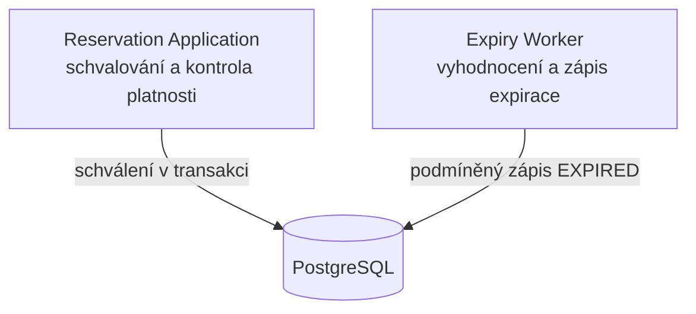
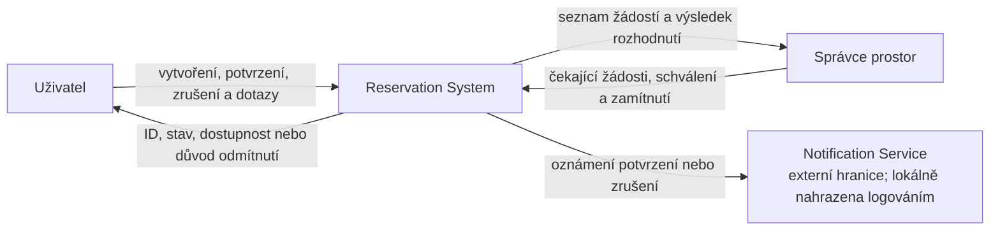
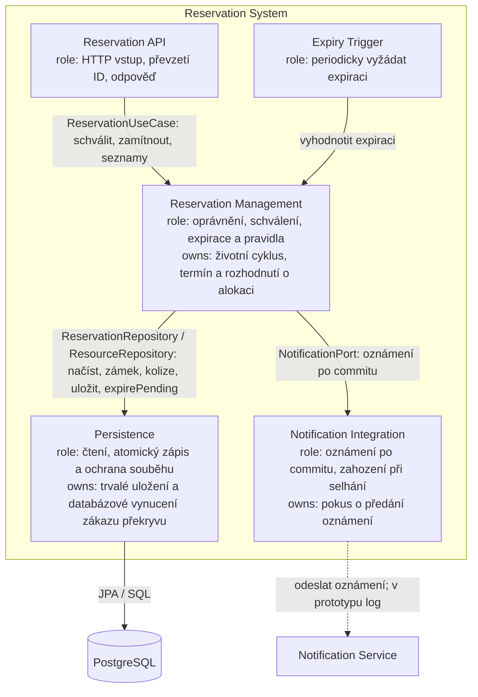
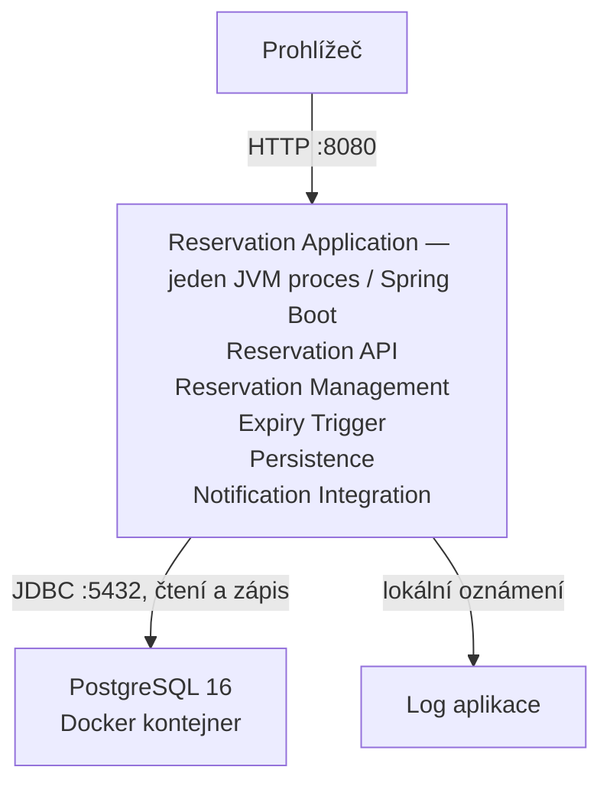
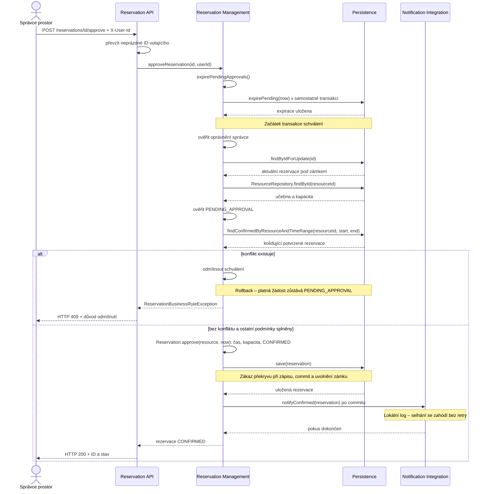
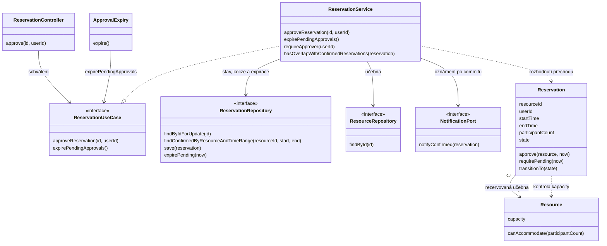

# Architektura a architektonická rozhodnutí

Tento dokument zachycuje hlavní technologická a architektonická rozhodnutí pro projekt "Rezervační systém učeben" a vysvětluje kontext, který k těmto rozhodnutím vedl.

Dokument popisuje architekturu rezervačního systému včetně schvalování speciálních prostor. Požadované chování určuje [specifikace v0.2](specification-v0.2.md).

## 1. Technologický stack

Pro implementaci byl zvolen následující stack, který klade důraz na spolehlivost, transakční bezpečnost a snadnou údržbu.

*   **Jazyk:** Java 21
    *   *Důvod:* Průmyslový standard pro backendové enterprise aplikace. Verze 21 přináší vlastnosti jako `record` (ideální pro DTO a Value Objects) a Pattern Matching, které zpřehledňují doménovou logiku.
*   **Framework:** Spring Boot 4.1.1.
    *   *Důvod:* Zrychluje vývoj díky auto-konfiguraci, poskytuje robustní Dependency Injection a snadnou tvorbu REST API.
*   **Databáze:** PostgreSQL
    *   *Důvod:* PostgreSQL poskytuje ACID transakce a databázové omezení `EXCLUDE USING gist`, které používáme jako pojistku proti uložení překrývajících se potvrzených rezervací stejné učebny.
*   **Verzování schématu:** Flyway
    *   *Důvod:* Zajišťuje konzistentní a opakovatelné migrace databázových tabulek `resource` a `reservation` napříč prostředími. Identifikátor uživatele ukládáme ve sloupci `reservation.user_id`; samostatnou tabulku uživatelů nemáme.
*   **Build nástroj:** Maven
    *   *Důvod:* Deklarativní správa závislostí a standardizovaný build proces, snadno integrovatelný s CI/CD.
*   **Testování:** JUnit 5, Mockito, Testcontainers
    *   *Důvod:* Doménovou logiku lze testovat bleskově pomocí JUnit a Mockito. Pro databázové integrace použijeme Testcontainers, které nastartují reálný PostgreSQL v Dockeru, čímž eliminujeme falešnou pozitivitu in-memory databází (např. H2).

---

## 2. Architektonický styl: Hexagonální architektura

Systém je navržen pomocí **Hexagonální architektury** (známé také jako Ports and Adapters). Cílem je striktně oddělit čistou business logiku od technických detailů (databáze, HTTP rozhraní, externí služby).

### Rozvrstvení aplikace

1.  **Doménová vrstva (Core / Centrum hexagonu)**
    *   Neobsahuje **žádné** závislosti na frameworku (Spring) ani databázi.
    *   Obsahuje entity `Resource` a `Reservation`. Uživatel je reprezentován pouze identifikátorem `userId` v rezervaci, nikoli samostatnou entitou `User`.
    *   Řídí stavy: `DRAFT`, `PENDING_APPROVAL`, `CONFIRMED`, `CANCELLED`, `REJECTED`, `EXPIRED`.
    *   Kapacitu kontrolujeme při vytvoření rezervace a při skutečné alokaci — potvrzení běžné učebny nebo schválení speciálního prostoru.
    *   U speciálních prostor žádost čeká na rozhodnutí správce. Doména ověřuje oprávnění, stav a platnost žádosti; při dosažení začátku již rozhodnutí nepovolí.
    
2.  **Porty (Rozhraní na okraji domény)**
    *   **Inbound porty (Driving):** Rozhraní pro vytvoření, potvrzení, schválení, zamítnutí a zrušení rezervace, ověření dostupnosti a čtení učeben, vlastních rezervací a čekajících žádostí.
    *   **Outbound porty (Driven):** Rozhraní, která doména potřebuje k fungování (např. `ReservationRepository` pro uložení dat, `NotificationPort` pro odeslání zprávy).

3.  **Adaptéry (Infrastruktura)**
    *   **Inbound adaptéry:** REST Controllery, které přijímají HTTP požadavky, mapují je na příkazy a volají Inbound porty.
    *   **Outbound adaptéry:**
        *   *PostgresAdapter:* Implementuje repozitáře pomocí Spring Data JPA a překládá doménové objekty na databázové entity.
        *   *NotificationAdapter:* Implementuje `NotificationPort` (naše Boundary). V prototypu loguje oznámení do konzole; skutečná Notification Service zatím není integrována.
    *   **Časový proces:** `ApprovalExpiry` pravidelně vyhodnocuje prošlé čekající žádosti a přes repository port ukládá přechod do `EXPIRED`. Expirace probíhá také před čtením seznamů a rozhodovacími operacemi, nezávisle na výsledku následného požadavku.

---

## 3. Záznamy o architektonických rozhodnutích (ADR)

### ADR-001: Použití Hexagonální architektury místo vrstvené (N-Tier)
*   **Kontext:** Potřebujeme aplikovat jasná doménová pravidla a integrovat externí Boundary (`Notification Service`). Běžná vrstvená architektura často vede k prolnutí databázových entit s business logikou.
*   **Rozhodnutí:** Použijeme Hexagonální architekturu.
*   **Důsledky:** 
    *   *Pozitivní:* Doménová pravidla (kapacita, stavy) jsou 100% nezávislá na technologiích a snadno testovatelná. Notifikace lze snadno mockovat.
    *   *Negativní:* Vyšší režie na psaní kódu (nutnost mapovat mezi DTO, Doménovými modely a JPA entitami).

### ADR-002: Zajištění pravidla "Rezervace se nesmějí překrývat"
*   **Kontext:** Dvě potvrzené rezervace stejné učebny se nesmějí časově překrývat. Může nastat situace, kdy dva uživatelé potvrdí DRAFT rezervaci na stejný čas ve stejnou milisekundu.
*   **Rozhodnutí:** `ReservationService` před potvrzením rezervace ověřuje překryv s existujícími potvrzenými rezervacemi přes `ReservationRepository`. Databázovou pojistku tvoří již implementovaný constraint `no_overlapping_confirmed_reservations` v migraci `V1__init.sql`. Používá `EXCLUDE USING gist` s rozšířením `btree_gist` nad `resource_id` a intervalem `tsrange(start_time, end_time)`. Platí pouze pro stav `CONFIRMED`; rezervace ve stavech `DRAFT` a `CANCELLED` tímto omezením nejsou blokovány. Navazující intervaly bez překryvu jsou povolené.
*   **Důsledky:** PostgreSQL odmítne konfliktní zápis i při obejití aplikační kontroly. Integrační test s reálnou PostgreSQL přes Testcontainers ověřuje odmítnutí druhé překrývající se potvrzené rezervace při postupném vkládání. Skutečný souběh dvou transakcí zatím tímto testem ověřen není.

### ADR-003: Modelování uživatele
*   **Kontext:** Uživatel může být Student nebo Vyučující. Z hlediska rezervace se ale jejich role neliší.
*   **Rozhodnutí:** Pro účely tohoto ohraničeného kontextu (Bounded Context) modelujeme uživatele pouze jako `userId` v doménovém objektu `Reservation`, uložené jako `user_id` v tabulce `reservation`. Samostatná entita ani tabulka `User` neexistuje. Autentizaci a rozlišování rolí má podle návrhu zajišťovat externí systém identity (např. přes JWT tokeny v REST adaptéru); tato integrace zatím není implementována.

### ADR-004: Read-only endpointy pro frontend

*   **Kontext:** Specifikace v0.1 definuje čtyři operace (vytvořit, potvrdit, zrušit, ověřit dostupnost) a žádná z nich nevrací seznam. Frontend potřebuje vědět, jaké učebny existují a jaké rezervace má přihlášený uživatel.
*   **Rozhodnutí:** Přidat `GET /resources` (seznam učeben) a `GET /reservations` (vlastní rezervace přihlášeného uživatele). Obě operace jsou jen čtení a nemění žádné byznys pravidlo ani stav.
*   **Důsledky:**
    *   *Pozitivní:* Frontend nemusí mít učebny natvrdo ani si pamatovat rezervace v prohlížeči. Pravidlo BR-05 platí i pro čtení: uživatel vidí pouze své rezervace.
    *   *Negativní:* API je širší než specifikace v0.1. Pokud se specifikace bude revidovat, měla by tyto operace převzít.


### ADR-005: Souběžné změny stejné rezervace

Confirm a Cancel běží v transakci a načítají rezervaci s PostgreSQL řádkovým zámkem (`PESSIMISTIC_WRITE`). Čekající operace po získání zámku vyhodnotí aktuální stav a čas serveru. Zámek trvá do commitu nebo rollbacku. Tím se zabrání pozdnímu přepsání CANCELLED a dvěma úspěšným opakováním stejného přechodu. Různé rezervace zůstávají chráněné proti kolidující alokaci constraintem z ADR-002. Oznámení se předává až po commitu; selhání se zahodí podle BR-07. Nevýhodou je čekání na právě měněný řádek. Integrační HTTP testy pokrývají Confirm/Cancel, opakované Confirm i Cancel a dvě konfliktní potvrzení.


### ADR-006: Perzistentní schvalovací proces a expirace

Učebna nese requiresApproval, čekání a výsledky rozhodnutí jsou stavy uložené rezervace. Běžná učebna potvrzuje automaticky, speciální přejde do PENDING_APPROVAL bez blokace. Schvalovatelé jsou serverový seznam ověřených ID; klient neposílá důvěryhodnou roli. Lokalní identita zůstává prototypová X-User-Id. Approve a Reject používají stejnou transakční ochranu jako Confirm/Cancel (ADR-005), proti kolidujícím schválením platí ADR-002.

Platnost čekání končí při start. Infrastructure timer po jedné sekundě provádí idempotentní podmíněný SQL přechod PENDING_APPROVAL → EXPIRED. Stejný přechod běží před seznamy a rozhodnutím v oddělené transakci, aby odmítnuté pozdní rozhodnutí nevrátilo zpět expiraci. Doména navíc kontroluje čas po získání zámku. Interval timeru je technické rozhodnutí, ne business lhůta; může mít zpoždění při nedostupnosti databáze. Perzistence umožní po restartu dohledat prošlé žádosti. Zamítnutí, čekání a expirace neposílají oznámení potvrzení; Approve oznámí až po commitu.

Driver pro C03: oddělení časového procesu, správa rolí a bezpečný souběh timeru s rozhodnutím. Distribuované instance mohou provést sken opakovaně; podmíněný zápis je idempotentní. Produkční plánování a autentizace nejsou cílem tohoto prototypu.

---

## C03 — Část A: současná realizace schválení rezervace

AS-IS zachycuje implementaci po C02 před změnami C03. Původní názvy metod a vazby zde ponecháváme jako podklad pro deltu J.

### A1. Vybraný scénář

| Položka | Hodnota |
|---|---|
| Scénář | OP-05 — Approve Reservation, [specifikace v0.2](specification-v0.2.md#op-05--approve-reservation) |
| Požadavky | REQ-06–08, REQ-14 |
| Pravidla | BR-01–03, BR-05–09 |
| Baseline | Specification Baseline v0.2 |

Doklady níže odkazují na třídy v `src/src/main/java/cz/vsb/reservation/`. Testy jsou v odpovídajících balíčcích v `src/src/test/java/cz/vsb/reservation/`.

### A2. Hlavní průchod v kódu

| Krok scénáře | Realizace | Doklad |
|---|---|---|
| Přijmout požadavek a ověřit identitu správce | API přijme ID rezervace a identitu; služba ověří serverový seznam správců. | `infrastructure/web/ReservationController.approve()`, `RequestIdentity.require()`, `domain/service/ReservationService.requireApprover()` |
| Vyhodnotit expiraci a načíst aktuální rezervaci | Expirace proběhne v samostatné transakci. Schválení běží v další transakci a načte rezervaci pod řádkovým zámkem. | `infrastructure/config/BeanConfiguration.reservationUseCase()` — `refreshExpiry()` a override `approveReservation()`; `infrastructure/persistence/ReservationJpaRepository.findByIdForUpdate()` |
| Ověřit čekající stav, učebnu a dostupnost | Služba načte učebnu, ověří PENDING_APPROVAL a hledá překryvy s CONFIRMED. | `domain/service/ReservationService.approveReservation()`, `hasOverlapWithConfirmedReservations()` |
| Ověřit čas a kapacitu, změnit stav | Doménový objekt vyžaduje now < start a dostatečnou kapacitu; přejde do CONFIRMED. | `domain/model/Reservation.approve()`, `requirePending()`, `transitionTo()` |
| Uložit alokaci | Adaptér uloží stav; databáze vynutí zákaz překryvu i při souběhu. | `infrastructure/persistence/ReservationRepositoryAdapter.save()`, migrace `V1__init.sql` — `no_overlapping_confirmed_reservations` |
| Oznámit potvrzení a vrátit výsledek | Po commitu se oznámení zaloguje; API vrátí HTTP 200, ID a CONFIRMED. | `infrastructure/config/BeanConfiguration` — `afterCommit()`; `infrastructure/notification/LoggingNotificationAdapter.notifyConfirmed()`, `ReservationController.approve()` |

### A3. Chybová větev: obsazená učebna

| Chování v0.2 | Zjištění podmínky | Rozhodnutí | Výsledek pro volajícího |
|---|---|---|---|
| Kolize odmítne schválení; platná žádost zůstane PENDING_APPROVAL. | `ReservationJpaRepository.findConfirmedOverlapping()` | `ReservationService.approveReservation()` vyhodí `ReservationBusinessRuleException` před změnou stavu. | `RestExceptionHandler.handleBusinessRule()` vrátí HTTP 409, `BUSINESS_RULE_VIOLATION` a zprávu. |

Doklad: `infrastructure/web/ApprovalWorkflowApiTest.competingRequests_recheckAvailabilityAtApproval()` kontroluje odmítnutí druhého schválení a zachování PENDING_APPROVAL. Při souběhu konflikt zachytí také databázový constraint; `RestExceptionHandler.handleConstraint()` jej převádí na HTTP 409. V dohledaném průchodu a této větvi jsme nezjistili rozdíl proti v0.2. Služba kontroluje kolizi před časem a kapacitou; všechny kontroly proběhnou před uložením alokace.

### A4. Hlavní části implementace

| Část (logická skupina) | Třídy | Role / doklad |
|---|---|---|
| Reservation API | `ReservationController`, `RequestIdentity`, `RestExceptionHandler` | Přijetí požadavku, identita a HTTP výsledek; `approve()`, `require()`, `handleBusinessRule()`. |
| Reservation logic | `ReservationService`, `Reservation`, `Resource` | Oprávnění, konflikt, čas, kapacita a změna stavu; `approveReservation()`, `approve()`. |
| Transaction and expiry | `BeanConfiguration`, `ApprovalExpiry` | Transakce schválení, samostatná expirace a oznámení po commitu; `reservationUseCase()`, `expire()`. |
| Persistence | `ReservationRepositoryAdapter`, `ReservationJpaRepository`, `ReservationJpaEntity`, `ResourceRepositoryAdapter`, `ResourceJpaRepository`, `ResourceJpaEntity` | Načtení pod zámkem, dotaz na kolize, uložení a podmíněná expirace. |
| Notification integration | `LoggingNotificationAdapter` | Lokální realizace `NotificationPort`; `notifyConfirmed()`. |

### A5. Stav a pravidlo BR-02

| Otázka | Odpověď a doklad |
|---|---|
| Kde je stav trvale uložen? | PostgreSQL, sloupec `reservation.state`; mapování přes `ReservationJpaEntity` a `ReservationRepositoryAdapter`. Stavy schvalování doplňuje migrace `V3__approval_workflow.sql`. |
| Kdo rozhoduje a provádí schválení? | `ReservationService.approveReservation()` řídí operaci; `Reservation.approve()` ověřuje čas a kapacitu a mění doménový stav. Adaptér změnu ukládá v transakci z `BeanConfiguration`. |
| Kde se zjistí konflikt? | `ReservationJpaRepository.findConfirmedOverlapping()` hledá CONFIRMED stejné učebny s překrývajícím se intervalem. |
| Kde se rozhodne podle BR-02? | `ReservationService.hasOverlapWithConfirmedReservations()` a `approveReservation()` odmítnou známý konflikt. PostgreSQL constraint `no_overlapping_confirmed_reservations` odmítne konfliktní zápis při souběhu. |
| Kde se provede výsledná změna? | `Reservation.transitionTo()` mění stav v paměti; `ReservationRepositoryAdapter.save()` ukládá CONFIRMED. Samostatný přechod do EXPIRED provádí `ReservationJpaRepository.expirePending()`, spouštěný z `ApprovalExpiry` i `BeanConfiguration`. |

### A6. Relevantní závislosti

| Závislost | Napojení | Kdo zná technické API / doklad |
|---|---|---|
| PostgreSQL | `ReservationRepository` a `ResourceRepository` | Persistence adaptéry a JPA repozitáře; `findByIdForUpdate()`, `findConfirmedOverlapping()`, `save()`, `expirePending()`; SQL migrace. |
| Transakce a časové spouštění | Obalení use case a periodický sken | `BeanConfiguration` používá `TransactionTemplate` a `TransactionSynchronization`; `ApprovalExpiry` používá `@Scheduled`. |
| Oznámení | `NotificationPort` | `LoggingNotificationAdapter` zná logovací API. Externí Notification Service v současném průchodu nevoláme. |
| Identita a oprávnění | Hlavička `X-User-Id` a konfigurace `reservation.approvers` | `RequestIdentity.require()`, `BeanConfiguration` a `ReservationService.requireApprover()`. Externí IdP v prototypu nevoláme. |

### A7. AS-IS strukturální diagram

Bloky jsou logické skupiny tříd z A4. Šipky zachycují současná volání a závislosti přes porty.



### A8. Otázka pro návrh architektury

| Položka | Obsah |
|---|---|
| Otázka | Kde má být vlastněna expirace čekající žádosti a jak má spolupracovat se schválením, aby souběh zachoval BR-06 a BR-09? |
| Doklad | Schválení mění stav přes `Reservation.approve()`, expirace přímo přes SQL v `ReservationJpaRepository.expirePending()`. Expiraci spouští `ApprovalExpiry.expire()` i `BeanConfiguration.refreshExpiry()`. |
| Proč je důležitá | Schválení a expirace mění stejný uložený stav různými cestami. Architektura musí jasně určit odpovědnost za časový přechod a zajistit, že pozdní schválení neobnoví vypršelou žádost. |

## C03 — B. Architektonické drivery

Vycházíme ze specifikace v0.2, scénáře OP-05 a nálezů z Části A.

| Podklad / zdroj | Proč ovlivňuje architekturu | Otázka pro architekturu |
|---|---|---|
| REQ-14, REQ-16; BR-04, BR-06, BR-09; A5/A8 | Schválení a expirace mění stejný stav. Při dosažení startu už schválení nesmí uspět ani při souběhu. | Kdo vlastní životní cyklus čekající žádosti a jak koordinuje schválení s expirací? |
| BR-09; OP-08; A2/A6 | Čekání musí přežít konec requestu i restart a expirace musí fungovat bez otevřeného prohlížeče. | Kde je uložen stav a termín žádosti a kdo vyhodnotí prošlé žádosti po restartu? |
| REQ-06, REQ-14; BR-02; A3/A5 | Dvě různé žádosti mohou při souběhu obě zjistit volnou učebnu. Nejvýše jedna smí získat kolidující alokaci. | Kde se autoritativně vynutí zákaz překryvu při zápisu schválení? |
| REQ-14; BR-05; A2/A6 | Schvalovat smí pouze správce ze serverového seznamu. V prototypu přebíráme ID z X-User-Id; skutečná autentizace je předpoklad externího IdP. | Kde se převezme ID volajícího a kde se ověří oprávnění schválit? |
| REQ-08; BR-07; A2/A6 | Oznámení patří až k uloženému potvrzení. Jeho selhání nesmí vrátit rezervaci do čekání ani změnit úspěšný výsledek. | Kde se oddělí commit rezervace od pokusu o oznámení? |

## C03 — C1. Doménový třídní model

Model zachycuje pojmy pro schválení rezervace, nikoli implementační třídy. Uživatel je v kódu reprezentován `userId`, interval dvojicí časů; schvalování je součástí stavu rezervace, nemá samostatnou entitu.



## C03 — C2. Odpovědnosti systému

Používáme OP-05 a související expiraci OP-08. Každá odpovědnost má jednoho hlavního vlastníka; konkrétní architektonické prvky určíme po porovnání alternativ.

| Zdroj | Odpovědnost | Co musí rozhodovat / vlastnit | Jasný vlastník a důvod | S čím seskupit | Od čeho oddělit |
|---|---|---|---|---|---|
| BR-05 | Získat ID volajícího | Převzetí neprázdného X-User-Id; bez něj odmítnout požadavek. | Ano; stejná kontrola vstupu pro schvalovací operace. | Přijetí požadavku. | Rozhodnutí o oprávnění a uložení rezervace. |
| REQ-14; BR-05 | Ověřit oprávnění správce | Porovnání ID se serverovým seznamem správců. | Ano; žádná cesta nesmí obejít oprávnění. | Pravidla přístupu ke schvalování. | Převzetí ID z HTTP a klientské UI. |
| REQ-14; BR-03/04/06 | Rozhodnout schválení | Přechod PENDING_APPROVAL → CONFIRMED, platnost a kapacita | Ano; jednotné rozhodnutí nad aktuálním stavem. | Životní cyklus, expirace a podmínky alokace. | HTTP, databázové API a oznámení. |
| REQ-16; BR-09 | Vyhodnotit expiraci | Přechod PENDING_APPROVAL → EXPIRED při now >= start. | Ano; musí používat stejnou časovou hranici jako schválení. | Stav a časová pravidla čekající žádosti. | Technické spouštění timeru. |
| REQ-06; BR-02/06 | Zachovat nekolidující alokaci | Zákaz překryvu i při souběžných zápisech | Ano; samotný předběžný dotaz není záruka. | Atomické uložení skutečného potvrzení. | Informativní dotaz na dostupnost. |
| BR-06/09 | Trvale uložit a koordinovat změny | Stav, termín a atomický zápis aktuálního výsledku | Ano; stav musí přežít request i restart. | Ochrana souběhu schválení, rušení a expirace. | Business politika a HTTP. |
| REQ-08; BR-07 | Předat oznámení potvrzení | Pokus po commitu, zahození při selhání bez retry | Ano; jedno místo určuje význam selhání. | Izolace technického způsobu oznámení. | Rozhodnutí a commit rezervace. |

## C03 — D. Hlavní rozhodovací otázka

**Rozhodovací otázka:** Kde má být vlastněna expirace čekající žádosti a jak má spolupracovat se schválením, aby při souběhu platily BR-06 a BR-09?

Otázka vychází z prvních dvou driverů a nálezu A8: schválení mění stav přes doménový objekt, expirace přes podmíněný databázový zápis spouštěný ze dvou míst. Rozhodnutí ovlivní vlastnictví přechodů, interakce i runtime.

V E porovnáme dvě varianty: společné řízení schválení a expirace v jedné aplikaci a samostatný proces pro expiraci, který koordinuje změny nad stejnými uloženými žádostmi.

## C03 — E1. Dvě architektonické alternativy

### Alternativa A — expirace ve stejné aplikaci



Schválení a expirace mají společného vlastníka životního cyklu v jedné aplikaci. Timer pouze vyžádá expiraci. Stav a termín žádosti jsou uložené v databázi.

### Alternativa B — samostatný expirační proces



Schválení provádí aplikace, expiraci samostatně spouštěný a nasazovaný worker. Oba používají stejný uložený stav, hranici start a databázovou ochranu změn. Aplikace musí odmítnout pozdní schválení i při výpadku workeru.

## C03 — E2. Porovnání vůči driverům

| Driver / kritérium | Alternativa A | Alternativa B |
|---|---|---|
| BR-06/09: souběh schválení a expirace | Společný vlastník definuje přechody a časovou hranici. Transakce a podmíněné zápisy chrání uložený stav. | Přechody provádějí dva procesy. Musí dodržovat stejnou časovou hranici a pravidla zápisu; databáze koordinuje souběh. |
| BR-09: čekání, restart a výpadek | Stav přežije restart v databázi. Po spuštění aplikace sken vyhodnotí prošlé žádosti. Při výpadku aplikace se zápis EXPIRED odloží. | Worker může vyhodnocovat expiraci i při výpadku aplikace. Při výpadku workeru se zápis EXPIRED odloží, aplikace stále odmítá pozdní schválení. |
| BR-02: nekolidující alokace | Schválení ukládá CONFIRMED s databázovým zákazem překryvu; samotný dotaz na dostupnost nestačí. | Stejná ochrana je nutná v aplikaci. Oddělení expirace neřeší souběh dvou kolidujících schválení. |
| BR-05: oprávnění správce | Oprávnění kontroluje schvalovací cesta. Timer může požadovat pouze časový přechod do EXPIRED. | Oprávnění kontroluje aplikace. Worker nepotřebuje identitu správce, ale potřebuje přístup k uloženým žádostem a možnost zápisu expirace. |
| BR-07: oznámení po commitu | Schválení předá oznámení až po commitu; expirace nic neoznamuje. | Stejně; worker nesmí odesílat oznámení potvrzení. |

## C03 — E3. Průchod stejným scénářem

Používáme OP-05 — Approve Reservation. Komplikací je souběh schválení s expirací při dosažení začátku rezervace.

| Krok / událost | Alternativa A | Alternativa B |
|---|---|---|
| Žádost čeká na správce | PENDING_APPROVAL a start jsou uložené v PostgreSQL; původní request již skončil. | Stejné; worker čte uložené žádosti nezávisle na původním requestu. |
| Správce zahájí schválení | Aplikace ověří oprávnění a načte rezervaci pod zámkem. | Stejné v aplikaci. |
| Schválení získá zámek před startem | Po získání zámku ověří stav, aktuální čas, kapacitu a kolizi. Při splnění podmínek uloží CONFIRMED. | Stejné; workerův podmíněný zápis nesmí přepsat CONFIRMED. |
| Současně se spustí expirace | Společné řízení změní pouze PENDING_APPROVAL s now >= start. Pokud mezitím uspělo schválení, rezervaci přeskočí. | Worker provede stejný podmíněný zápis; databáze jej koordinuje s transakcí aplikace. |
| Expirace získá řádek jako první při now >= start | Uloží EXPIRED; následné schválení načte konečný stav a vrátí 409. | Worker uloží EXPIRED; aplikace následně načte konečný stav a vrátí 409. |
| Schválení čeká na zámek až do startu | Po získání zámku znovu ověří čas a schválení odmítne. Expirace uloží EXPIRED při skenu nebo vyhodnocení před operací. | Aplikace schválení odmítne podle času i tehdy, pokud worker ještě nestihl uložit EXPIRED. |
| Expirační proces neběží | Zápis EXPIRED se odloží; po obnovení aplikace se prošlé žádosti vyhodnotí. | Při výpadku workeru aplikace dál obsluhuje požadavky a odmítá pozdní schválení; worker po obnovení vyhodnotí prošlé žádosti. |
| Schválení uspěje | Po commitu následuje pokus o oznámení. Jeho selhání nezmění CONFIRMED ani úspěšný výsledek. | Stejné v aplikaci. |

## C03 — F. ADR

### ADR-007 — Vlastnictví expirace čekající žádosti

**Kontext:** Po C02 schvalujeme žádost přes doménový objekt, ale expiraci zapisujeme přímo podmíněným databázovým příkazem. Spouští ji timer i kontrola před operacemi. Potřebujeme jasně určit vlastníka přechodů nad stejným stavem.

**Drivery:** Souběh schválení a expirace (BR-06/09), perzistentní čekání a obnova po restartu (BR-09), nekolidující alokace (BR-02), oprávnění správce (BR-05) a oznámení po commitu (BR-07).

**Alternativa A:** Schválení i expirace řídí společný vlastník životního cyklu v jedné aplikaci; timer pouze spouští vyhodnocení.

**Alternativa B:** Expiraci provádí samostatný worker nad stejnou databází; aplikace samostatně kontroluje platnost při schválení.

**Rozhodnutí:** Volíme alternativu A. Životní cyklus čekající žádosti má jednoho logického vlastníka pro schválení i expiraci. Technické spouštění a databázové provedení jsou oddělené odpovědnosti. Zachováme perzistentní stav, ochranu souběhu a kontrolu času při rozhodnutí.

**Důvod:** Projekt běží jako jedna aplikace. Společné řízení umožňuje udržovat pravidla přechodů na jednom místě a nepotřebuje další nasazovaný proces. Průchod scénářem ukazuje, že při databázové koordinaci změn a kontrole času splňuje požadované chování.

**Přijaté negativní důsledky:** Při výpadku aplikace se uložená expirace odloží. Sken sdílí prostředky se zpracováním požadavků. Podmíněný databázový zápis musí odpovídat pravidlům životního cyklu; jednoho logického vlastníka nelze zajistit pouze názvem komponenty.

**Rozhodnutí znovu otevřeme, když:** Bude nutné vyhodnocovat expiraci i při odstávce aplikace nebo expirační sken začne významně zpomalovat obsluhu požadavků.

ADR-007 zpřesňuje ownership z ADR-006. Konkrétní prvky a povolené vazby zachytíme v G; rozdíly proti současné implementaci vyhodnotíme v J.

## C03 — G1. Kontext systému



V prototypu oba aktéři předávají ID přes `X-User-Id`. Skutečný IdP není připojený, proto jej nezobrazujeme jako používaný systém. Databáze a timer jsou součástí realizace systému, nikoli externí aktéři.

## C03 — G2. TO-BE statická architektura

Používáme pět logických prvků. Reservation Management je podle ADR-007 společný vlastník schválení i expirace; časový spouštěč pouze vyžádá vyhodnocení.



| Odpovědnost z C2 | Hlavní vlastník |
|---|---|
| Získat ID volajícího | Reservation API |
| Ověřit oprávnění správce | Reservation Management |
| Rozhodnout schválení | Reservation Management |
| Vyhodnotit expiraci | Reservation Management |
| Zachovat nekolidující alokaci | Reservation Management; Persistence vynucuje zákaz překryvu při zápisu. |
| Trvale uložit a koordinovat změny | Persistence |
| Předat oznámení potvrzení | Notification Integration; Reservation Management předání vyžádá až po commitu. |

API ani Expiry Trigger nemění stav přímo přes Persistence. Databázový příkaz pro expiraci je provedení přechodu řízeného Reservation Management. Technické transakční obalení a callback po commitu patří k realizaci tohoto řízení.

## C03 — G3. Vlastnictví přechodů ve statechartu

Vycházíme z [existujícího statechartu v0.2](diagrams/state-v0.2.png). Podmínky přechodů zůstávají podle BR-04/09; doplňujeme vlastníky z G2.

| Přechod | Owner rozhodnutí | Kdo může přechod pouze vyžádat |
|---|---|---|
| DRAFT → PENDING_APPROVAL | Reservation Management | Reservation API na žádost vlastníka. |
| DRAFT → CONFIRMED | Reservation Management | Reservation API na žádost vlastníka běžné učebny. |
| PENDING_APPROVAL → CONFIRMED | Reservation Management | Reservation API na žádost správce. |
| PENDING_APPROVAL → REJECTED | Reservation Management | Reservation API na žádost správce. |
| PENDING_APPROVAL → EXPIRED | Reservation Management | Expiry Trigger; vyhodnocení probíhá také v Reservation Management před relevantní operací. |
| DRAFT / PENDING_APPROVAL / CONFIRMED → CANCELLED | Reservation Management | Reservation API na žádost vlastníka, podle časových podmínek zdrojového stavu. |

Persistence provádí uloženou změnu a chrání souběh, ale neurčuje oprávnění ani business podmínky přechodu.

## C03 — G4. Runtime / deployment mapping



Všechny logické prvky z G2 běží v jedné aplikaci podle alternativy A. Expiry Trigger používá plánování ve stejném JVM; nemá samostatný proces. PostgreSQL trvale ukládá žádosti a vynucuje zákaz překryvu. Frontend servíruje aplikace a běží v prohlížeči. Externí Notification Service ani IdP nejsou v lokálním runtime připojené.

Mapování do kódu: Reservation API → web controllery a `RequestIdentity`; Reservation Management → `ReservationService`, `Reservation`, `Resource` a transakční obalení v `BeanConfiguration`; Expiry Trigger → `ApprovalExpiry`; Persistence → repository adaptéry, JPA repozitáře a migrace; Notification Integration → `LoggingNotificationAdapter`. Přímé volání repository z dnešního timeru v A7 je rozdíl proti povoleným vazbám G2, který zahrneme do delty J.

## C03 — H1. Návrhový sekvenční diagram

Používáme OP-05 — Approve Reservation z C02 a Části A. Diagram realizuje TO-BE z G2; transakční řízení je součástí Reservation Management.



Čas se ověřuje po získání zámku, přímo před změnou doménového stavu. Pokud mezitím nastala expirace nebo byl dosažen start, schválení se odmítne. Databázový konflikt při souběžném zápisu také vede k rollbacku a HTTP 409. Pro přehlednost diagram rozepisuje pouze jednu alternativní větev — již obsazenou učebnu.

## C03 — H2. Zaměřený návrhový třídní diagram

Zobrazujeme třídy a rozhraní potřebné pro stejný scénář. `ReservationService` s doménovými objekty realizuje Reservation Management; transakce a callback po commitu zajišťuje obalení v `BeanConfiguration` podle G4.



| Lifeline / operace z H1 | Vlastník v návrhu |
|---|---|
| Reservation API: přijetí schválení, ID a HTTP výsledek | `ReservationController` s existujícími `RequestIdentity` a `RestExceptionHandler`. |
| Reservation Management: oprávnění, konflikt a orchestrace | `ReservationService`; čas, kapacitu a přechod ověřuje `Reservation.approve()`. |
| Persistence: rezervace, učebna, zámek, uložení a expirace | `ReservationRepository` a `ResourceRepository`, realizované adaptéry z G4. |
| Notification Integration: oznámení | `NotificationPort`, realizovaný `LoggingNotificationAdapter`; callback po commitu zajišťuje `BeanConfiguration`. |

`expirePendingApprovals()` je navržená operace pro jednotné vyžádání expirace podle ADR-007. Timer ji volá přes inbound port místo přímého volání repository. Doplnění této operace proti AS-IS zahrneme do J.

## C03 — I. Cross-view kontrola

Kontrolu jsme provedli před změnou kódu pro OP-05 a související expiraci.

| Kontrola | Výsledek |
|---|---|
| C02 ↔ G2 | Návrh pokrývá oprávnění správce, platnost a kapacitu žádosti, zákaz kolize, expiraci i oznámení po commitu. Pravidla v0.2 neměníme. |
| C2 ↔ G2 | Všech sedm odpovědností má hlavního vlastníka v tabulce G2. Rozhodnutí o přechodech vlastní Reservation Management, databázové provedení Persistence. |
| G2 ↔ H1 | Sekvence používá pouze API → Management, Management → Persistence a Management → Notification Integration. Interní kontroly zůstávají v Management. |
| H1 ↔ H2 | Schválení vlastní `ReservationService` a `Reservation`; repository operace a oznámení mají odpovídající rozhraní. Do H1 jsme doplnili explicitní volání navržené `expirePendingApprovals()`. |
| Statechart ↔ G3/H1 | Schválení PENDING_APPROVAL → CONFIRMED řídí Reservation Management. Tentýž prvek řídí expiraci, která mění pouze prošlé čekající žádosti. |
| G2 ↔ G4 | Všech pět logických prvků je namapováno do jedné Spring Boot aplikace. PostgreSQL je samostatný runtime prvek; oznámení lokálně realizuje logovací adaptér. |
| ADR ↔ G2/G4 | ADR-007 je viditelné ve společném vlastníkovi přechodů a vazbě Expiry Trigger → Reservation Management, vše v jednom procesu. |

Zpřesnili jsme také H1: kontrola oprávnění běží uvnitř transakce schválení, stejně jako v současném obalení use case. Rozdíl AS-IS → TO-BE je přímé volání repository z timeru a chybějící společná vstupní operace expirace; zachycujeme jej v J. Další obsahový rozpor mezi uvedenými pohledy jsme nezjistili.

## C03 — J. AS-IS → TO-BE delta

Porovnáváme Část A s přijatým návrhem G/H. `CHANGE` znamená změnit kód, `KEEP` zachovat řešení a `VERIFY` ověřit jeho dodržení.

| Oblast | AS-IS | TO-BE | Akce |
|---|---|---|---|
| Vstup expirace | `ReservationUseCase` a `ReservationService` nemají operaci pro vyžádání expirace. | Doplnit `expirePendingApprovals()` do inbound portu a služby; služba určí čas a požádá repository o podmíněný přechod. | CHANGE |
| Periodický spouštěč | `ApprovalExpiry` zná repository, hodiny a transakční manager a přímo provádí sken. | `ApprovalExpiry` pouze volá `ReservationUseCase.expirePendingApprovals()`; čas a transakci zajišťuje Reservation Management. | CHANGE |
| Expirace před operacemi | `BeanConfiguration.refreshExpiry()` volá přímo repository v samostatné transakci. | Stejná vstupní operace expirace pro timer i kontroly před operacemi; samostatnou transakci zachovat. | CHANGE |
| Schválení a souběh | Doménové kontroly, načtení pod řádkovým zámkem a databázový zákaz překryvu. | Zachovat kontroly, aktuální čas po získání zámku a ochranu zápisu podle BR-02/06. | KEEP |
| Uložené čekání a expirace | Stav i start jsou v PostgreSQL; podmíněný zápis mění pouze prošlé PENDING_APPROVAL. | Zachovat schéma a podmíněný databázový zápis jako provedení řízeného přechodu. | KEEP |
| Identita a oprávnění | Neprázdné X-User-Id a serverový seznam správců. | Stejný prototypový vstup a serverová kontrola schvalování. | KEEP |
| Oznámení | Callback po commitu, logovací adaptér, zahození při selhání. | Stejné chování podle BR-07. | KEEP |
| Chování po změně expirace | Existující testy pokrývají schválení, konflikty, hranici expirace a souběh; test skenu vytváří timer s repository. | Upravit zapojení testu timeru a znovu ověřit relevantní příklady C02. | VERIFY |
| Architektonická vazba timeru | ArchUnit chrání hexagon, ale neomezuje závislosti `ApprovalExpiry`. | Opakovatelně ověřit, že timer používá inbound port a nezávisí na repository, persistence ani transakčním API. | VERIFY |

Změny omezujeme na cestu vyžádání expirace. Business pravidla, databázové schéma a veřejné HTTP endpointy zůstávají podle v0.2.

## C03 — K. Implementace

Provedli jsme všechny tři řádky CHANGE z J:

- Do `ReservationUseCase` a `ReservationService` jsme přidali `expirePendingApprovals()`. Služba určuje aktuální čas a vyžádá podmíněný zápis přes repository.
- `ApprovalExpiry` volá pouze inbound port; nezná repository, hodiny ani transakční manager.
- `BeanConfiguration` obaluje společnou operaci transakcí a používá ji před rozhodovacími operacemi i seznamy. Expirace se commitne před následnou transakcí rozhodnutí, stejně jako před změnou.

Upravili jsme zapojení existujícího testu expiračního skenu. Aplikace se zkompilovala a integrační testy ji spustily přes HTTP proti PostgreSQL v Testcontainers.

Commit implementace: `c0642a7f74a10819649aa694ccd28cb18533071f` — Route approval expiry through reservation use case.

## C03 — L1. Ověření chování

Spustili jsme ze složky `src`:

```powershell
.\mvnw.cmd '-Dtest=ReservationTest,ReservationServiceTest,ArchitectureTest,ApprovalWorkflowApiTest,ReservationLifecycleApiTest' test
```

Výsledek: **86 testů, 0 selhání, 0 chyb, 0 přeskočení, BUILD SUCCESS** (11. 10. 2026).

| Ověření | Výsledek | Doklad |
|---|---|---|
| Úspěšné schválení | PENDING_APPROVAL → CONFIRMED, interval následně blokuje; opakování odmítnuto. | `ApprovalWorkflowApiTest.delayedApproval_doesNotBlock_untilApproved()` |
| Konflikt při schválení | Druhá kolidující žádost odmítnuta, zůstává PENDING_APPROVAL. | `ApprovalWorkflowApiTest.competingRequests_recheckAvailabilityAtApproval()` |
| Hranice expirace a sken bez uživatelské operace | Přesně při start EXPIRED; rozhodnutí odmítnuto. Timer volá stejný use case a ukládá expiraci. | `exactStart_expiresAndCannotBeApprovedOrCancelled()`, `expiryScanner_materializesExpiredWithoutUserAction()` |
| Souběh | Dvojí Approve, Approve/Reject, Approve/Cancel a kolidující schválení zachovávají pravidla. | Souběžné testy v `ApprovalWorkflowApiTest`; původní Confirm/Cancel také v `ReservationLifecycleApiTest`. |
| Původní doménová pravidla | Čas, kapacita, přechody a chování služeb nadále procházejí. | `ReservationTest`, `ReservationServiceTest`. |

## C03 — L2. Ověření architektonického pravidla

**Architektonické pravidlo:** Expiry Trigger vyžádá expiraci přes inbound port; nesmí přímo používat repository, persistence, doménové objekty/službu, hodiny ani transakční API.

**Kontrola:** ArchUnit pravidlo `ArchitectureTest.expiryTriggerUsesInboundPort`. Opakovatelně spustitelné příkazem `.\mvnw.cmd '-Dtest=ArchitectureTest' test` ze složky `src`.

**Výsledek:** Pravidlo prošlo spolu se čtyřmi původními pravidly hexagonální architektury. Kontrola chrání vazbu Expiry Trigger → Reservation Management z G2 a ADR-007.
